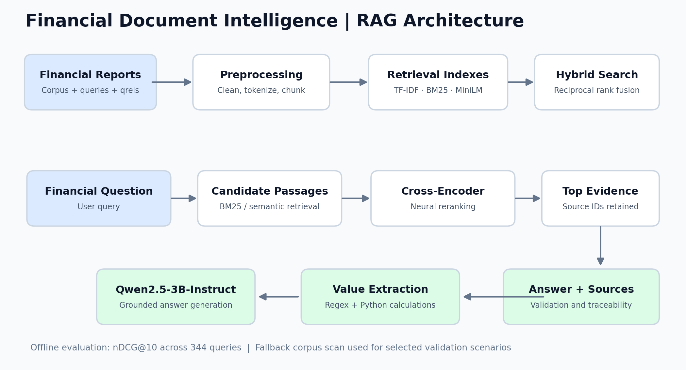
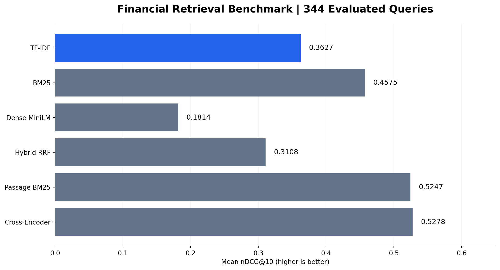

# Financial Document Intelligence: End-to-End RAG Pipeline

A Jupyter notebook project for financial-report question answering using retrieval-augmented generation (RAG), passage retrieval, reranking, and evidence-based financial calculations.



## What this project does

- Loads a financial-document corpus, questions, and relevance judgments.
- Compares TF-IDF, BM25, MiniLM dense retrieval, and reciprocal rank fusion (RRF).
- Splits documents into overlapping passages and ranks relevant evidence.
- Uses a cross-encoder to rerank candidate passages.
- Generates evidence-grounded answers using **Qwen2.5-3B-Instruct**.
- Extracts numerical values from selected financial disclosures and applies Python calculations.
- Retains document/chunk identifiers to trace supporting evidence.

## Retrieval results



| Retrieval configuration | Mean nDCG@10 |
|---|---:|
| TF-IDF | 0.3627 |
| BM25 | 0.4575 |
| Dense MiniLM | 0.1814 |
| Hybrid RRF | 0.3108 |
| Passage-level BM25 | 0.5247 |
| BM25 + cross-encoder | **0.5278** |

These are saved notebook results for **344 evaluated queries**. Some configurations use different retrieval/candidate settings; interpret comparisons as experimental results rather than isolated causal improvements.

## Financial calculations

The notebook includes six scenario-specific financial extraction and calculation checks: environmental reserves, tax-credit investments, share repurchases, employee stock purchase plan (ESPP), aircraft fuel, and net profit margin adjustments. The final notebook records **6/6 successful financial calculation scenarios** after updating evidence selection logic. Some scenarios use expanded retrieval or full-document fallback, so these checks do not measure end-to-end chatbot accuracy.

## Technology

Python, pandas, NumPy, scikit-learn, rank-bm25, sentence-transformers (all-MiniLM-L6-v2 and ms-marco-MiniLM-L-6-v2), Hugging Face Transformers, PyTorch, Google Colab / Jupyter.

## How to run

1. Open `Financial_Document_Intelligence_RAG.ipynb` in Google Colab.
2. Install the dependencies shown in the notebook's environment setup section.
3. Supply `corpus.jsonl`, `queries.jsonl`, and `FinQA_qrels.tsv` in Google Drive. Check the original dataset's licensing and distribution terms before sharing any data.
4. Update the notebook's `DATA_PATH`, embedding directory, and output directory to match your environment.
5. Use an appropriate runtime for the Qwen model and run notebook sections in order.

**Note:** The notebook uses Google Drive paths and may require a GPU and substantial memory for the LLM. The data files and model weights are not included in this portfolio package.

## Project layout

```text
financial-document-intelligence-rag/
├── Financial_Document_Intelligence_RAG.ipynb
├── README.md
└── assets/
    ├── rag_architecture.png
    └── retrieval_benchmark.png
```

## Limitations

- Financial-value extraction is scenario-specific and not a general-purpose financial statement parser.
- Successful arithmetic checks do not independently establish correctness of source evidence or generated responses.
- Some validation paths scan additional passages or the full corpus when initial retrieval misses relevant years.
- Model output can vary with runtime, prompting, and library versions.

## Portfolio purpose

Demonstrates practical information retrieval, ranking evaluation, RAG orchestration, source traceability, and deterministic numerical processing in financial documents.
